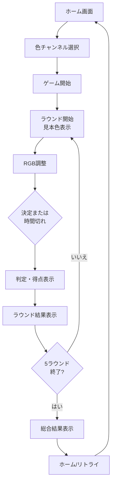

# ゲーム設計

## 概要

プレイヤーはランダムに提示される見本色に対して、RGB各スライダーを操作して調整する。制限時間内に決定するか時間切れになると、その時点の調整色を回答として採点する。5ラウンド終了後に総合結果を表示する。

## ゲーム進行フロー

## ラウンド構成

各ラウンドの処理：

1. **ラウンド開始** — 見本色（ランダムなRGB値）とラウンド番号を表示。制限時間を設定
2. **色調整** — RGBスライダーを操作し、色をプレビューで確認
3. **回答確定** — 決定ボタンまたは時間切れで調整を終了
4. **採点表示** — 判定、得点、割合を表示
5. **ラウンド結果** — 見本色、回答色、スコアなどの結果をUIに表示

## 制限時間

| ラウンド | 秒数 | 計算式 |
|---|---:|---|
| 1 | 15.00 | 15 × 0.9^(1-1) |
| 2 | 13.50 | 15 × 0.9^(2-1) |
| 3 | 12.15 | 15 × 0.9^(3-1) |
| 4 | 10.94 | 15 × 0.9^(4-1) |
| 5 | 9.84 | 15 × 0.9^(5-1) |

各ラウンドで前ラウンドの0.9倍の時間が与えられる。

## プレイヤー体験

### 観察と調整

見本色を視認しながらRGBスライダーを操作し、リアルタイムでプレビューに反映される調整色を確認する。色合わせが主要な操作。その他の移動、攻撃、ステージ選択などの要素はない。

### 制限時間と決定

時間内に決定ボタンを押すか、時間切れになると自動的に現在の調整値を回答として確定する。両者とも同一の採点処理へ進む。

### 結果表示

ラウンド終了ごとに判定、得点、割合をUIで表示し、プレイヤーに即座にフィードバックを与える。全5ラウンド終了後に合計スコア、最終ランク、各ラウンドの詳細結果を表示する。

## UI構成

### ホーム画面

- 色チャンネル一覧と選択
- RGB値の事前調整とプレビュー
- スコア履歴表示（最大100件）
- 音量オプション（BGM/SE）
- ゲーム開始ボタン

### ゲーム画面

- 見本色表示
- ラウンド番号、残り時間
- RGB各スライダー
- 調整色プレビュー
- 決定ボタン
- ラウンド結果パネル
- 判定テキスト（Perfect/Excellent/Great/Good/Bad）
- 総合結果パネル（ランク、合計スコア、各ラウンドの色プレビューと得点）
- ホーム/リトライボタン

## 実装構成

| システム | 主要クラス | 処理内容 |
|---|---|---|
| 進行管理 | GameManager | ラウンド進行、タイマー、採点タイミング |
| RGB入力 | AdjustUIAreaController, AdjustSlider | スライダー値管理、プレビュー更新 |
| 採点結果 | ResultController, ResultData | 色差計算、判定、得点算出 |
| 結果表示 | RoundResult, AllRoundTotalResult | UI更新、ランク表示 |
| 判定演出 | JugementUI | テキスト表示、音声、画面効果 |
| ホーム画面 | HomeManager, SelectModePanel | モード選択、履歴表示 |
| データ管理 | CoreResource, ColorChannelDataSO | ゲーム状態、色データ保持 |
| オーディオ | AudioManager, AudioDataSO | BGM/SE再生 |