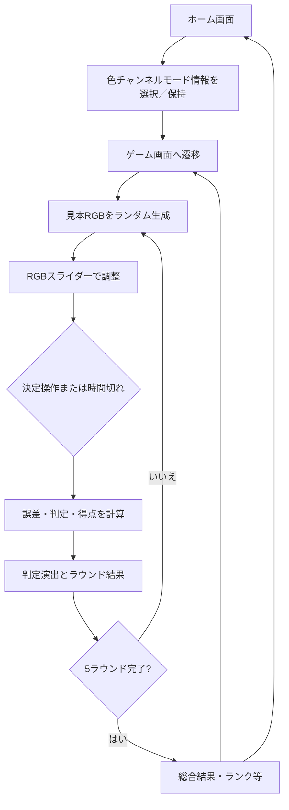

# ゲームデザイン・体験設計

## 1. デザインの核

**実装確認済み**：プレイヤーはランダムに提示される見本色に対して、赤・緑・青の各スライダーを操作し、調整色を近づける。制限時間または決定操作で回答を確定し、色差に応じた判定・得点を得る。

**設計意図の推定**：色を「感覚だけで選ぶ」のではなく、成分を調整し、結果を振り返る短い反復課題として構成している。後半ほど制限時間を短くすることで、精度と判断速度の両方を意識させる設計と考えられる。これらの意図を明文化した企画資料は確認できない。

## 2. プレイヤー体験

### 観察と調整

見本色を視覚的に確認し、RGB値を操作しながら現在の調整色をプレビューする。スライダー変更時には値・プレビュー・背景色が同期し、操作に応じた効果音も再生される。調整そのものがゲームの中心であり、移動・攻撃などのアクションは確認できない。

### 制限時間と決定

各ラウンドは有限時間で進行する。プレイヤーは明示的に決定でき、時間切れの場合も現在のスライダー値で同じ結果処理へ進む。時間切れが別の敗北状態になるのではなく、「その時点の回答を採点する」挙動である。

### フィードバックと振り返り

ラウンド終了時に、誤差から算出した判定・割合・得点を表示する。判定表示は効果音、カメラ揺れ、Bloom/Vignette等の視覚効果を伴う。全ラウンド後は合計結果とランクを提示し、スコア履歴をホーム画面から参照できる構成がある。

## 3. 基本ゲームループ

図は `GameManager` のコルーチン進行と結果クラス群の実装に基づく。リトライはゲームシーン再読込として実装されている。

## 4. 進行と感情曲線

| フェーズ | 実装された進行 | 体験上の役割（推定） |
|---|---|---|
| 開始 | モード情報を保持し、ホームからゲームシーンへ | 調整方法／色の見方を切り替える入口 |
| ラウンド開始 | 見本色とラウンド番号を表示 | 新しい色課題を提示 |
| 調整 | RGBスライダー、色プレビュー、時間制限 | 観察・試行錯誤・判断 |
| ラウンド結果 | 誤差、判定、得点を提示 | 自分の色合わせを即時評価 |
| 総合結果 | 5ラウンドの合計やランク等を表示 | 連続課題を振り返り、再挑戦へつなぐ |

制限時間を短縮する仕組みは確認できるが、時間表示の具体的な演出、チュートリアル、難易度選択、ステージ進行は確認できない。

## 5. モード／再プレイ要素

`ColorChannelDataSO` はモード名・ジャンル情報・説明・RGBチャンネルに関連するマテリアルを保持する。ホーム画面の選択結果は `CoreResource` を介してゲーム画面へ渡る。ただし、リポジトリ内のアセット数から多様なモードが十分に用意されているとは断定できない。

最終結果からホーム画面への遷移とゲームシーンの再読込がある。スコア履歴は存在する一方、プロセス終了後も保持される保存機構は確認できない。

## 6. 差別化・評価上の留意点

- **実装上の特徴**：RGB三成分の直接操作、色プレビュー、誤差に基づく段階評価が一連につながっている。
- **差別化の主張範囲**：これはコードから確認できる特徴であり、市場比較に基づく独自性の証明ではない。
- **デザイン上の課題**：画面上の色再現性、色覚多様性への対応、入力補助、判定閾値の妥当性、時間難易度のプレイテスト結果は確認できない。
- **設計意図と事実の区別**：色彩学習を目的としている、反射神経を鍛える等の目的は明示されていないため、本資料では断定しない。

## 7. 根拠

- ラウンド進行・見本色生成：`Assets/Scripts/GamePlay/GameManager.cs`
- RGB調整と色表示：`Assets/Scripts/GamePlay/AdjustColor/AdjustSlider.cs`、`AdjustUIAreaController.cs`
- 採点・判定：`Assets/Scripts/GamePlay/Result/ResultController.cs`、`Assets/Scripts/Constants/ValueConstants.cs`
- モードデータ：`Assets/Scripts/ScriptableObjects/ColorChannelDataSO.cs`
- ホーム進行：`Assets/Scripts/Home/HomeManager.cs`、`HomeUIModuleManager.cs`
