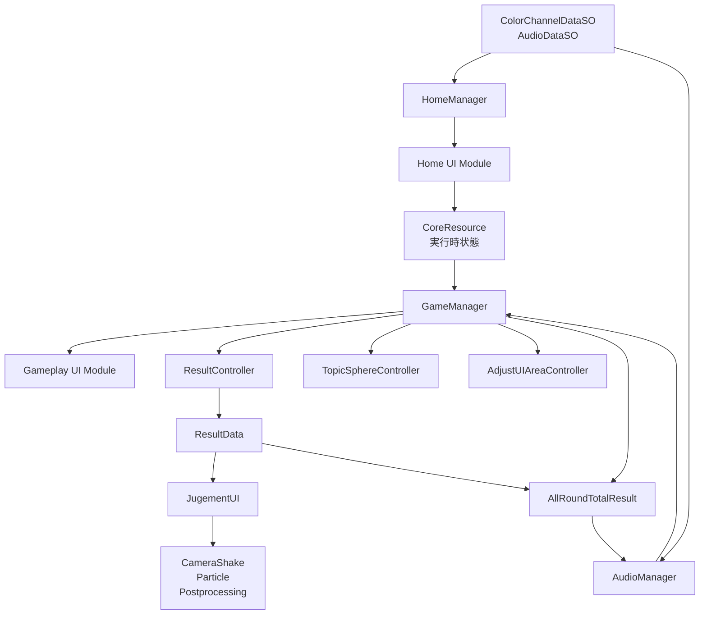
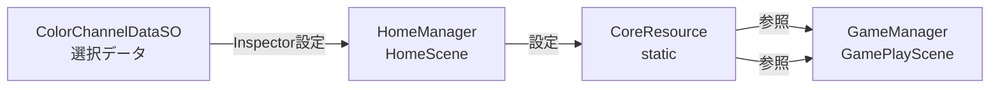
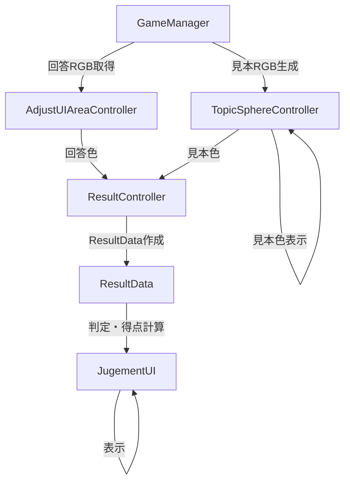
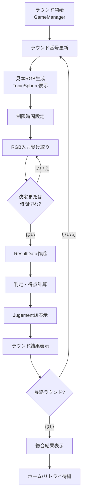
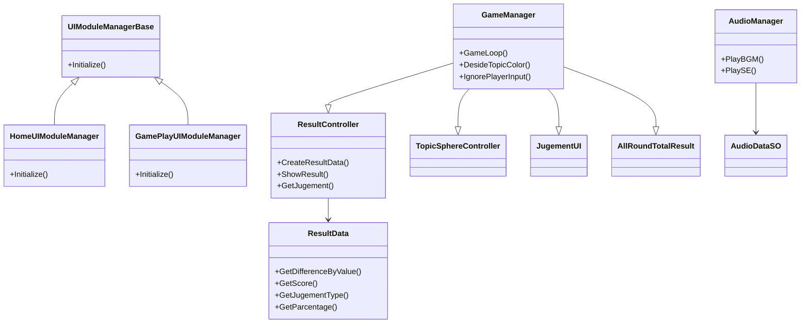

# システム構成

## 1. アーキテクチャ概要



システムは2つのシーン（HomeScene, GamePlayScene）で構成。GameManagerのCoroutineが5ラウンドの進行フローを制御。ScriptableObjectで色・音声データ、CoreResourceで実行時状態を管理。

## 2. 主要システム

| システム | 構成クラス | 責務 |
|---|---|---|
| **ホーム・モード選択** | HomeManager, HomeUIModuleManager, SelectModePanel, CoreResource | 色チャンネルデータの選択、ホームUI初期化、モード情報の共有 |
| **RGB入力** | AdjustUIAreaController, AdjustSlider, PreviewSlider | スライダーイベント処理、RGB値保持、プレビュー更新 |
| **ゲーム進行** | GameManager, ValueConstants | ラウンドループ、タイマー、見本色生成、採点タイミング |
| **採点・結果** | ResultController, ResultData, RoundResult, AllRoundTotalResult | 色差計算、判定、得点算出、ラウンド/総合結果表示 |
| **判定演出** | JugementUI, CameraShake, GameClearParticleController | 判定テキスト、効果音、カメラ揺れ、パーティクル、ポストプロセス |
| **UI基盤** | UIModuleManagerBase, GamePlayUIModuleManager | UI Toolkit要素の取得と画面別モジュール初期化 |
| **オーディオ** | AudioManager, AudioDataSO | BGM/SEの取得と再生 |
| **情報表示** | TopicPreviewAreaController, TopicSphereController | ラウンド、タイマー、見本色の更新 |

## 3. データフロー

### シーン間データ共有



ColorChannelDataSOを選択し、CoreResourceに保存。GamePlaySceneで参照。

### ラウンド内データフロー



GameManagerが見本色を生成してTopicSphereControllerで表示。AdjustUIAreaControllerから回答色を取得。ResultControllerがResultDataを作成し、判定・得点を計算。

## 4. ラウンド処理フロー



GameManager.GameLoop()がCoroutineで制御。見本色生成から採点、結果表示まで一連の処理を管理。

## 5. クラス構造



UIModuleManagerBaseを継承した画面別マネージャー。GameManagerが複数の結果・表示クラスを参照。

## 6. 参照パターン

### Inspector設定による参照

GameManagerとAllRoundTotalResultはSerializeFieldで以下を参照：
- TopicSphereController
- JugementUI
- GameClearParticleController
- UIDocument

### コンポーネント取得による参照

UIModuleManagerBase派生クラスがUIDocumentからUIModuleControllerを取得：
```
UIDocument.GetComponent<UIModuleControllerType>()
```

### 静的参照

- `GameManager.I`（シングルトン）
- `AudioManager.I`（シングルトン）
- `CoreResource`（staticクラス）

### UI要素の名前指定

UIToolkitの要素をQ<T>メソッドで名前取得。要素名の変更がコンパイル時に検出されない。

## 7. シーン構成

### HomeScene

- HomeManager（MonoBehaviour）
- UIDocument（HomeUIModuleManager, SelectModePanel等を保持）
- AudioSource（BGM再生）
- コンポーネント参照で色データと音声データを保持

### GamePlayScene

- GameManager（MonoBehaviour）
- UIDocument（GamePlayUIModuleManager, ResultController, AllRoundTotalResult等を保持）
- TopicSphereController（見本色表示用オブジェクト）
- JugementUI（判定演出）
- GameClearParticleController（結果演出）
- AudioSource（SE再生）
- Camera（カメラ揺れ制御）
- Post Processing Volume（Bloom, Vignette）

## 8. 現在の技術課題

### 設計上の課題

- GameManagerが複数の具体クラスを直接参照（ResultController, JugementUI, AllRoundTotalResultなど）により、依存関係が複雑化
- CoreResourceとGameManager.I等の静的状態が複数存在、テスト困難
- UI要素を名前文字列で取得するため、要素名変更時にコンパイル時検出不可

### 実装上の課題

- ValueConstants.cs のランク判定でB条件がC条件より先に評価（現在Cランク到達不可）
- ScoreHistoryComposition でクリックハンドラー登録失敗
- BackButton.Reset() での異なるラムダ解除によるイベント残存
- UI Toolkitイベント登録と解除の寿命管理の脆弱性

詳細は[技術課題](./CodeReview.md)と[改善計画](./ImprovementPlan.md)を参照。