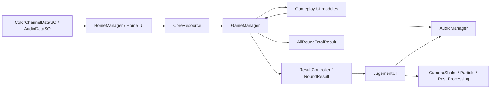
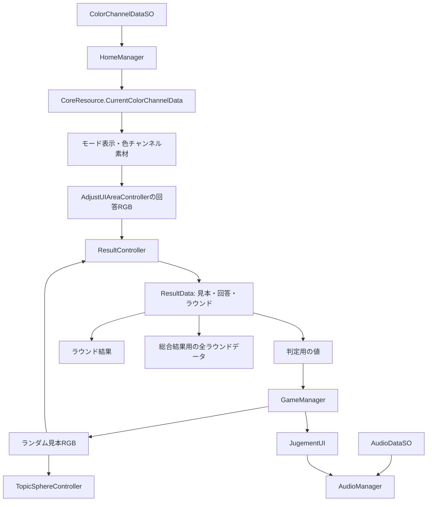
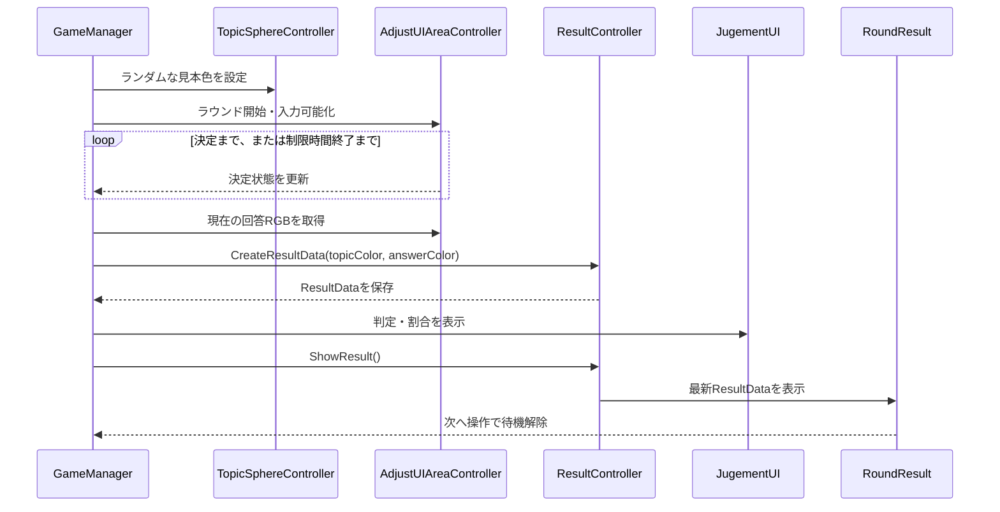
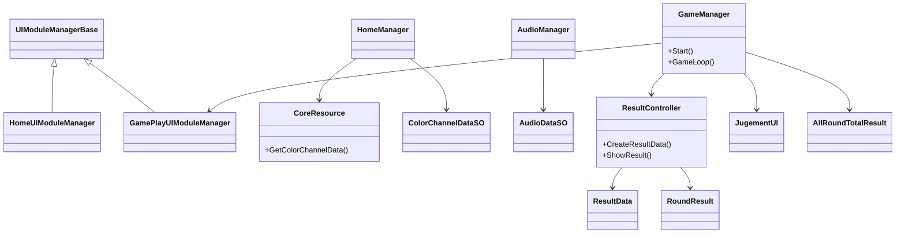

# システム構成・アーキテクチャ

## 1. 全体像

このプロジェクトは、ホーム／ゲームプレイの2シーンを、`MonoBehaviour`の管理クラスとUI ToolkitベースのUIモジュールで進行させる構成である。ゲーム進行の中心は `GameManager` のコルーチン。モード・オーディオの編集データはScriptableObject、シーン間や結果履歴の実行時データは静的クラス等で扱う。

図はC#参照と処理フローを要約したもの。具体的な参照の一部はInspector上のシーン設定に依存する。

## 2. システム一覧

| システム | 主な構成 | 責務・連携 |
|---|---|---|
| ホーム／モード | `HomeManager`、`HomeUIModuleManager`、`SelectModePanel`、`CoreResource` | 初期モード情報、ホームUI、ゲーム開始／遷移。 |
| RGB入力／プレビュー | `AdjustSlider`、`AdjustUIAreaController`、`PreviewSlider`、ホーム色プレビュー | チャンネル値を保持し、調整色をプレビューへ反映。ホームとゲーム中に近い操作を提供する。 |
| ゲーム進行 | `GameManager`、`ValueConstants` | ラウンド数・時間・見本生成・入力待ち・結果待ち・最終処理を順に実行。 |
| 採点／結果 | `ResultController`、`ResultData`、`RoundResult`、`JugementUI`、`AllRoundTotalResult` | 色差、判定、得点、ラウンド／総合表示を担当。 |
| UIモジュール共通化 | `UIModuleManagerBase`、`IPanelChangeElement`、`IUIModuleController` | UI要素の初期化やパネル切り替えを共通化する。要素の取得には文字列パスを使用。 |
| オーディオ | `AudioDataSO`、`AudioManager` | タグからBGM／SEクリップを解決して再生する。 |
| 演出 | `CameraShake`、`GameClearParticleController`、`JugementUI`、Animator／Volume | カメラ、パーティクル、アニメーション、ポストプロセス等の結果演出。 |
| 外部ランキング | `AllRoundTotalResult` とUnityroomクライアント依存 | 終了時にランキング送信を呼び出す実装がある。実運用上の成功は未検証。 |

敵、戦闘、Wave、ネットワーク対戦、セーブデータの独立システムは確認できない。

## 3. 主要なデータフロー

`ResultData` は構築後に値を変更できない形（private setter）で扱われる。色差／判定／得点は結果処理の中で算出される。モード情報の一部は `CoreResource` の静的状態を介してシーンをまたぐ。

## 4. ラウンド処理フロー

この図はコード上の依存を概略化したもの。直接呼び出しとInspector参照の詳細は、対象シーンのInspector設定をUnity Editor上で確認する必要がある。

## 5. クラス関係（概略）

継承関係と依存はスクリプト構造に基づく。`GameManager` から複数の具体クラスへ参照が集まっており、汎用的なイベントバスやDIコンテナを中心とする構成ではない。

## 6. シーン・アセット構成

- **HomeScene**：ホーム管理、UI管理、モード選択、履歴、オプション、色プレビュー、オーディオ等のスクリプトがシーンに結び付いている。
- **GamePlayScene**：`GameManager`、見本球、RGB調整、結果／判定、総合結果、演出、オーディオ等が存在する。
- Build Settings上はホームが先、ゲームプレイが次。
- Git管理対象のPrefabは確認できない。少なくとも確認したゲーム固有のオブジェクト構成はScene直置きであり、Prefab再利用を前提とした構成とは確認できない。
- ScriptableObjectアセットは色チャンネルデータと音声タグデータを確認。`Resources` フォルダーは空。
- UI Toolkit用の素材一式は存在するが、コード上の具体的な画面構造・実機表示はシーンとUnity Editorでの確認が必要。

## 7. 依存関係上の特徴とリスク

- `GameManager.I`、`AudioManager.I`、`CameraShake.I` 等の静的インスタンス参照と `CoreResource` の静的状態を使用する。シーン間連携は簡潔になる一方、初期化順序・テスト分離・シーン重複時の振る舞いに注意が必要。
- UI Toolkit要素の名前／階層を文字列で取得するため、UXML／シーン側の命名変更は実行時の欠落につながりやすい。
- シーン参照・演出コンポーネントの設定に依存する箇所があり、Inspector未設定を検出する一貫した検証機構は確認できない。
- `ScoreHistoryComposition` のボタン購読処理と `BackButton` の解除処理にはイベント配線上の不具合候補がある。詳細は[コードレビュー](./CodeReview.md)を参照。
